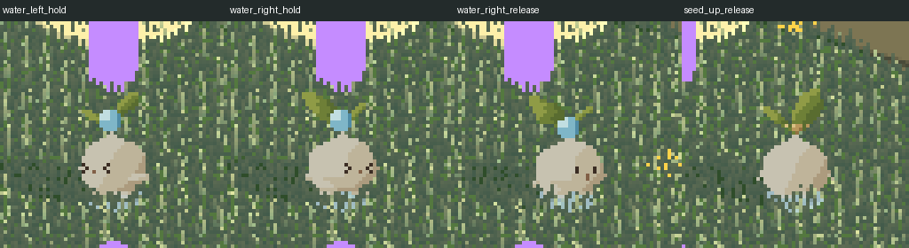

# SPR-01 発射4方向 独立検証

対象: 共有 `C:/godot/greenvader`、HEAD `151a53f20255489ef08481e2a353258cd8ac559c`＋未コミット差分。2026-10-20、Windows / Godot 4.7.2 / Vulkan Forward+ / NVIDIA GeForce RTX 5070 Ti。実装・素材担当の編集凍結とGodot停止後に開始した。

**集約: 12 PASS / 0 FAIL / 4 NOT_RUN。製品の修正を要する問題は見つからなかった。最終受入と新方向の美術評価は親・ユーザーが判断する。**

## 対象固定・方法

- 実装凍結 `game-self/target-hashes.json` のSHA256は `88dad85a62be78470779fb1c3e4cb5b0aa16dc4f15b8449d898c3ecbb39586f5`。終了時に206/206一致。素材担当の凍結203/203も一致（[audit-results.json](audit-results.json)）。検証時点の全対象は [target-hashes.json](target-hashes.json)、共有dirty状態は [git-status.txt](git-status.txt) に保存。
- 作業開始前の4scriptコピーを実ファイルと比較し、[reviewed-change.patch](reviewed-change.patch) を独立生成してレビュー。HEAD差分には今回以前の変更が含まれるため、今回差分の根拠として親の `parent-before/` を使った。
- 実装者の自己申告を判定の代用にせず、原寸PNG・全シート・元v3・採用静止画との画素比較、実コード、独立した入力/時間境界/投影の試験を使用した。自己GPU画像は別途目視した。
- 製品コード・素材・設定・共有文書を編集していない。編集は `tests/independent/spr01_fire_directions.gd` と本証拠フォルダのみ。Godotが専用試験の `.uid` を生成した。コミット・再委任なし。

## 条件別結果

| 条件 | 結果 | 確認内容・証拠 |
|---|---|---|
| 原寸・α・色・分離 | PASS | 全44キャラが24×36、元8色＋透明、二値α。44形成FXも24×36・二値α。4方向のシート各領域と個別PNG一致。[art-results.json](art-results.json) |
| 種の通常眼 | PASS | 顔が見える全方向全コマで両眼それぞれ縦1×2px。背面は顔なし。正面v3との差分は目周辺に限定。他の正面コマは同一。 |
| 正面水・飛翔の保全 | PASS | 水正面7キャラ＋7形成FXは旧v3と画素・PNG bytesとも一致。種・水8×8飛翔PNGも旧v3のbytes一致。 |
| 独立した左右・背面・足 | PASS | 左右は各コマが反転一致せず、既存静止絵に沿う非対称葉と手前向きの顔。上の全コマに目/口色なし。各方向の足元2行は動作中固定。コマ一覧も目視。 |
| 素材の時間 | PASS | 種 `[66,100,100,134]`、400ms・発射66ms。水 `[80,100,100,120,100,120,180]`、800ms・発射400ms。水の大玉保持コマと閉眼→発射開眼を確認。 |
| runtimeコピー・import | PASS | 原画からの99ファイル（98PNG＋manifest）がbytes一致。98import全件lossless、mipmap/alpha-border/premult/size-limit/自動3D圧縮なし。 |
| 凍結・既存保全 | PASS | runtime/コード206、source203の凍結一致。親の旧204保全ファイル全件一致。旧idle/walk・front-v3・ゲームデータ/保存処理/設定などを保持。 |
| 今回コード差分 | PASS | actorは4行atlas参照、down強制を除去。mainは現camera/向き更新後に方向socketを登録。表示オフセットのみ拡張しlogical shotへ追加しない。時計・費用・照準snapshot・保存の処理は変更なし。 |
| エンジン内入力・向き | PASS | 内部MouseMotion/MouseButton注入でwater左開始、溜め中に右へ向き変更。表示は右の同位相へ変わり、クリック時の論理照準は維持。上seedも背面絵。 |
| 実GPUの出口・現camera | PASS | 右へ向きを変えた水を移動同時に400msで発射。飛翔中心の実投影と描画足基準のsocketがともに `(320,180)`。論理targetは元の照準、originは発射時位置。上seed66msも同位置一致。 |
| 格子・影同期・復帰・実画面 | PASS | 独立GPUで24×36投影、整数の足元、表示と影の同texture/位置・反転なし、通常歩行/背面idleへの復帰を確認。独立GPU4枚および自己GPUの新3方向×2動作・各5位相を目視。 |
| 時刻・busy・停止・資源・取消 | PASS | 種65ms未発射/66ms一度だけ発射/400ms終了、水399ms保持/400ms一度だけ費用/800ms終了、busyで時計再開しない、資源0拒否、pause/suspend/menu停止、newgameの未発射取消・幽霊弾なし。 |
| 物理入力・物理ウィンドウ画素 | NOT_RUN | OS入力・カーソル移動・前面化は実施しない。 |
| 実速の操作感・最終美術採用 | NOT_RUN | ユーザーによる確認。位相画像は連続実操作録画ではない。 |
| 全照明/天候・性能・書出し・全回帰 | NOT_RUN | 今回の方向素材と表示差分に限定。 |
| 保存復元・栽培種の再試験 | NOT_RUN | 今回は実行せず、関係処理の差分なし/保全hashを確認。前回の検証を今回の再実行として数えない。 |

画素などの個別照合は **192 PASS / 0 FAIL**、専用logic＋独立GPUは **16 PASS / 0 FAIL**、凍結/import監査は **3 PASS / 0 FAIL**。上表はこれらと差分/目視を12条件へ集約したもので、単純合算の条件数ではない。

## 実行・画像

専用試験 `res://tests/independent/spr01_fire_directions.gd` をHidden起動、root.unfocusable、通常進行を停止し固定刻みで1回完走した。入力は `Input.parse_input_event` のみ。設定とsave先は本証拠領域へ分離した。通常のユーザーセーブを読み書きしていない。

[results.json](results.json)、[gpu.log](gpu.log)、[gpu-error.log](gpu-error.log)。終了コード0、script/runtime errorなし。sandboxの `user://` shader-cache生成エラーは既存と同様に出たが、GPU描画と試験は完走した。

左から水左溜め、水右へ向き変更、水右発射、種背面発射。同じカメラ範囲をnearest4倍で連結。原寸 `water_left_hold.png` / `water_right_hold.png` / `water_right_release.png` / `seed_up_release.png` も保存。

自己GPUの `game-self/game-directions-contact4x.png` は左/右/上×種/水の開始・保持・発射・飛翔・歩行復帰を目視。左右の葉形、両眼、水形成と分離、背面顔なしを確認した。追加の全方向GPU再走はしていない。

## 終了

凍結対象への検証中変更なし、Godotプロセス停止を確認。Godot/import共有資源を親へ返却する。未解決FAILなし。素材・ゲーム・文書の追加編集は停止する。
